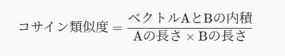

# ベクトルとコサイン類似度

## ベクトルとは？

**ベクトル**とは、ひとことで言うと「大きさ（量）」と「向き（方向）」の2つをセットにしたものです。

私たちが普段使っている「身長170cm」や「りんご3個」といった数字は「大きさ」だけ**を表します（これを**スカラー**と呼びます）。それに対して、ベクトルはそこに**「どっち向きか」という情報が加わります。

---

### 1. 日常のたとえでイメージする

一番わかりやすいのは「天気予報の風」**や**「移動の指示」です。

* **大きさだけの情報：**「風速 5m」
（どれだけ強いかはわかりますが、どっちに吹いているかわかりません）
* **ベクトル（大きさ＋向き）：**「**北東**に向かって、風速 **5m**」
（強さと向きの両方がセットになっています）

また、宝の地図に書かれた「ここから東へ3歩、北へ4歩進む」という矢印も、まさにベクトルそのものです。

---

### 2. 数字のペア（リスト）で表す

図で描くとベクトルは「矢印（→）」になりますが、コンピュータや数学で計算するときは、**数字を並べたリスト**として表します。

たとえば、スタート地点から「右（東）へ3、上（北）へ4」進む矢印は、次のように書きます。

$$\vec{v} = (3, 4)$$

* **数字の並び**を見れば「どの方向にどれだけ進むか（＝**向き**）」がわかります。
* 三平方の定理を使えば、矢印の全体の長さ（＝**大きさ**）も $\sqrt{3^2 + 4^2} = 5$ と計算できます。

---

### 3. なぜこれが便利なの？（ITやAIでの使われ方）

「矢印」の考え方を応用すると、目に見えないデータも数字のリスト（ベクトル）として扱えるようになります。

| 分野 | ベクトルの使われ方 | 具体例 |
| --- | --- | --- |
| **ゲーム・CG** | キャラクターの位置や動くスピード | 「右に2、上に5の勢いでジャンプする」 |
| **データ分析・AI** | モノや人の「特徴」を数値の並びにする | りんごの特徴を `[甘さ: 8, 酸味: 3, 赤さ: 9]` のように表す |

このように「特徴を数字のリストにまとめたもの」も、すべてベクトルと呼ばれます。たとえば AI が「この映画が好きなら、これも好きかも」とおすすめできるのは、映画の特徴をベクトルにして、「矢印の向きが似ている（＝特徴が似ている）映画」を計算で見つけているからです。

## 高次元ベクトル

データサイエンスの世界における **「高次元（こうじげん）ベクトル」** とは、ひとことで言うと **「1つのデータについて、たくさんの特徴（項目）をズラッと並べたリスト」** のことです。

2次元（項目が2つ）や3次元（項目が3つ）までは「矢印」として目で見ることができますが、データサイエンスでは **100次元や1,000次元** といった、人間には絵に描けないレベルの「長い数字のリスト」を日常的に使います。

---

### 1. 「次元が増える」とはどういうこと？

数学の「次元」という言葉は難しそうに聞こえますが、データサイエンスでは「データ（表）の列の数（特徴の種類の数）」だと思えば大丈夫です。

たとえば、ある「マンションの部屋」のデータを数字で表す場面を想像してみてください。

* **2次元ベクトル（特徴が2つ）：**
`[広さ(㎡), 駅からの徒歩分数]` → `[45, 5]`
※これなら、縦軸と横軸のグラフ（2次元の地図）に点を打てます。
* **3次元ベクトル（特徴が3つ）：**
`[広さ(㎡), 駅からの徒歩分数, 築年数]` → `[45, 5, 10]`
※縦・横・高さの立体（3D空間）のどこかに点を打てます。
* **5次元ベクトル（特徴が5つ）：**
`[広さ(㎡), 駅からの徒歩分数, 築年数, 階数, 家賃(万円)]` → `[45, 5, 10, 3, 9.5]`

このように、対象を詳しく説明するために「見るポイント（項目）」を増やしていくと、そのままベクトルの次元が増えていきます。特徴が100個あれば「100次元ベクトル」です。

---

### 2. 目に見えない「高次元」をどうイメージする？

4次元以上になると、私たちの目には立体として見えなくなります。そのため、データサイエンスでは次のようにイメージを切り替えます。

* **図形としてのイメージ（低次元）：** 空間に伸びる「矢印」
* **データとしてのイメージ（高次元）：** Excel（表計算ソフト）の「1行分のデータ」

| 物件名 | 広さ(㎡) | 徒歩(分) | 築年数 | 階数 | 家賃(万円) |
| --- | --- | --- | --- | --- | --- |
| **物件A** | 45 | 5 | 10 | 3 | 9.5 |
| **物件B** | 48 | 4 | 8 | 4 | 10.0 |

この表の「物件A」の横1行を抜き出した `[45, 5, 10, 3, 9.5]` が、5次元のベクトルです。

---

### 3. なぜわざわざ「高次元」にするの？

データサイエンスで高次元ベクトルを使う最大の理由は、「たくさんの条件をまとめて、コンピュータに『似ている・似ていない』を計算させるため」です。

たとえば、先ほどの表で「物件A」と「物件B」は、広さも駅からの距離も築年数も似ていますよね。
人間なら表を見て「あ、条件が近そうだな」と判断できますが、データが10万件、項目が100個になると人間には無理です。

そこでデータを高次元ベクトルにしておくと、コンピュータは「100次元の空間の中で、2つの点の距離がどれくらい近いか（または矢印の向きがどれくらい同じか）」を一瞬で計算できます。

* **画像データ：** 縦100×横100ピクセルの白黒画像なら、1万個の明るさの数字を並べた**10,000次元ベクトル**になります。
* **文章・ChatGPTなどのAI：** 言葉の意味を768個や1,536個の数値の特徴に分解した**高次元ベクトル**にすることで、「意味が似ている文章」を検索できます。

> **まとめのポイント**
> 高次元ベクトルとは、空間の矢印というよりも「対象の特徴を漏れなく詰め込んだ、数値のプロフィールカード」です。特徴をたくさん並べることで、AIやプログラムがデータの「類似度」や「パターン」を数学的に計算できるようになります。

## コサイン類似度

コサイン類似度（Cosine Similarity）**とは、2つのベクトル（数字のリスト）が**「どれくらい同じ向きを向いているか」を測ることで、データの「似ている度合い」を表す指標です。

データサイエンスやAI（おすすめ機能や文章検索など）で最もよく使われる計算方法のひとつです。

---

### 1. 直感的なイメージ：「矢印の角度」を見る

コサイン類似度では、矢印の「長さ（大きさ）」は無視**して、**「2本の矢印の間の角度（$\theta$）」だけに注目します。

* **角度が $0^\circ$（完全に同じ向き）：** 類似度は **1**（そっくり！）
* **角度が $90^\circ$（直角・無関係）：** 類似度は **0**（まったく関係ない）
* **角度が $180^\circ$（真逆の向き）：** 類似度は **-1**（正反対！）

つまり、コサイン類似度は必ず **$-1$ から $1$ の間** の数値になります。$1$ に近いほど「似ている」と判断します。

---

### 2. なぜ「長さ」ではなく「向き」を見るの？（具体例）

たとえば、ネット通販や動画配信サービスで、2人のユーザーの好みを比較する場面を考えてみましょう。
各ユーザーを `[アニメを見た数, スポーツを見た数]` という2次元ベクトルで表します。

* **Aさん（ライトユーザー）：** `[2, 1]`（アニメ2本、スポーツ1本）
* **Bさん（ヘビーユーザー）：** `[20, 10]`（アニメ20本、スポーツ10本）
* **Cさん（ライトユーザー）：** `[1, 2]`（アニメ1本、スポーツ2本）

もし単純な「数字の差（距離）」で比べると、AさんとBさんは視聴本数が大きく違うため「似ていない」と判定されてしまいます。

しかし、**比率（＝矢印の向き）**に注目するとどうでしょうか？
AさんもBさんも、**「スポーツの2倍、アニメを見る」という好みのバランスがまったく同じ**です。グラフに描くと、Aさんの短い矢印と、Bさんの長い矢印は**ぴったり重なります（角度 $0^\circ$）**。

* **AさんとBさんのコサイン類似度：** **$1.0$**（好みは完全に一致！）
* **AさんとCさんのコサイン類似度：** **$0.8$**（少し好みがズレている）

このように、「データの量（規模）は違うけれど、傾向やバランスが同じもの」を見つけられるのがコサイン類似度の最大の強みです。

---

### 3. どうやって計算するの？（3ステップ）

計算式は少し難しそうに見えますが、やっていることはとてもシンプルです。

先ほどの **Aさん `[2, 1]`** と **Cさん `[1, 2]`** で実際に計算してみましょう。

1. **同じ場所の数字を掛けて足す（内積）：**
$(2 \times 1) + (1 \times 2) = 2 + 2 = \mathbf{4}$
1. **それぞれの矢印の長さを出す（三平方の定理）：**
* Aさんの長さ：$\sqrt{2^2 + 1^2} = \sqrt{5} \approx \mathbf{2.236}$
* Cさんの長さ：$\sqrt{1^2 + 2^2} = \sqrt{5} \approx \mathbf{2.236}$

3. **割り算をする（長さの影響を打ち消す）：**
$\frac{4}{\sqrt{5} \times \sqrt{5}} = \frac{4}{5} = \mathbf{0.8}$

最後にそれぞれの「長さ」で割り算をすることで、矢印の長さをすべて「1」に揃え、純粋な「角度（向き）」だけを比べられる仕組みになっています。

---

### 4. 高次元でも計算はまったく同じ！

2次元（項目が2つ）でも、1,000次元（項目が1,000個）でも、やることは「同じ位置の数字を掛けて足し、それぞれの長さで割る」だけです。

たとえば文章の検索では、文章を「単語の出現回数」などの高次元ベクトルに変換します。長い論文（単語数が多い）と短い要約文（単語数が少ない）であっても、使われているキーワードの比率（ベクトルの向き）が同じであれば、コサイン類似度が高くなり「同じテーマの文章だ」とコンピュータが判定できます。
